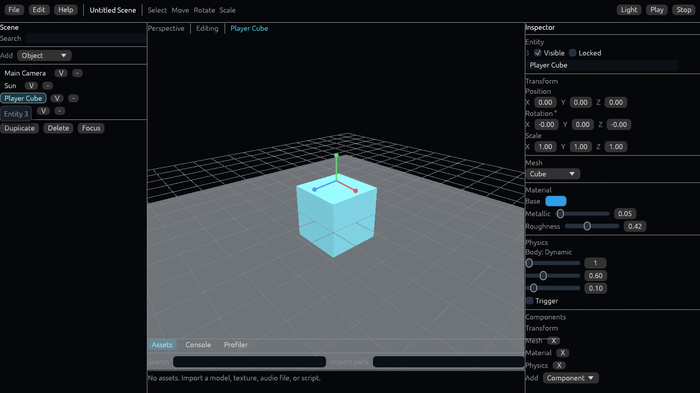

# CUBES

CUBES is an original Rust 3D creation platform focused on the Raspberry Pi 5. It contains a real
hardware-accelerated renderer, a visual editor with viewport picking and transform gizmos, a
standalone runtime, an asset/scripting pipeline, a sandboxed MCP server, and a repeatable GPU
benchmark.

Primary target: Raspberry Pi 5 Model B, Kali GNU/Linux aarch64, Vulkan through the Broadcom V3D
driver, with OpenGL as a capability-detected fallback.



## Quick start

```bash
. "$HOME/.cargo/env"

# Create and inspect a project
cargo run -p vela-cli -- new-project /tmp/my-game "My Game"
cargo run -p vela-cli -- inspect-project /tmp/my-game

# Inspect detected hardware and the selected graphics adapter
cargo run -p vela-cli -- hardware --backend vulkan

# Edit and play
cargo run -p vela-editor -- --project /tmp/my-game
cargo run -p vela-runtime -- /tmp/my-game

# Or install a double-clickable desktop app entry and launch "CUBES Editor"
desktop/install-desktop-app.sh

# MCP stdio server (argument is the workspace root allowed for project access)
cargo run -p vela-mcp -- "$PWD"

# Repeatable offscreen GPU benchmark
cargo run --release -p vela-bench -- --instances 512 --frames 300 --output docs/benchmarks/pi5-vulkan.json
```

## Workspace layout

- `apps/vela-cli` — hardware probe, project creation, project inspection.
- `apps/vela-editor` — winit/wgpu/egui editor with hierarchy, inspector, assets, console, profiler,
  real 3D viewport, play preview, and project open/save.
- `apps/vela-runtime` — standalone windowed player with scene camera, Lua hooks, simple dynamics,
  and live FPS reporting.
- `crates/vela-core` — project format, atomic JSON writes, canonical sandbox checks.
- `crates/vela-scene` — serializable scene graph and component schema.
- `crates/vela-ecs` — compact type-specific ECS with generation reuse.
- `crates/vela-platform` — CPU, memory, GPU, DRM, and thermal probe with quality policy.
- `crates/vela-renderer` — wgpu adapter selection, instanced meshes, glTF geometry import, grid,
  camera, PBR-style shader.
- `crates/vela-assets` — asset classification, checksum, and project-directory copy.
- glTF/GLB geometry and base-colour textures are decoded by `vela-renderer` and uploaded to the GPU;
  skins, animations, and advanced PBR maps are not yet used.
- `crates/vela-scripting` — embedded Lua 5.4 runtime.
- `crates/vela-mcp` — rmcp stdio server with tools, resources, prompts, and project sandboxing.
- `benchmarks/vela-bench` — deterministic offscreen GPU throughput benchmark.

## Project files

```text
my-game/
  project.vela.json
  scenes/main.velascene
  assets/
  scripts/
  builds/
  .vela/
```

## Vela compatibility

CUBES is a user-facing rename. Existing `project.vela.json`, `*.velascene`, `vela://` MCP resources,
tool names, and the legacy `Vela Editor` desktop launcher continue to work. Internal Rust crate
names remain unchanged to avoid breaking builds. No project migration is required.

## Documentation

- [Architecture](docs/ARCHITECTURE.md)
- [Dependencies](docs/DEPENDENCIES.md)
- [Hardware verification](docs/HARDWARE.md)
- [Tutorial](docs/TUTORIAL.md)
- [MCP interface](docs/MCP.md)
- [Benchmarks](docs/BENCHMARKS.md)
- [Feature status](docs/STATUS.md)
- [Product assessment](docs/CUBES_ASSESSMENT.md)
- [Handoff prompt](docs/HANDOFF_PROMPT.md)

CUBES is in active development. Read [STATUS.md](docs/STATUS.md) before relying on a feature.
